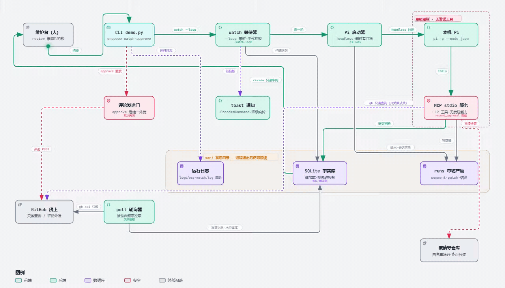

# 写在前面
本仓库实现了一个简单的Agent开发loop，一个以事件驱动的一轮值守loop
# 开源值守

本地事件（手动投递或按仓库频率轮询 GitHub）叫醒一轮**本机 headless Pi**：通过 MCP 读取白名单仓库、定向搜索代码和历史，提出建议、写评论与补丁草稿，然后通知你拍板。支持模拟发版、新 Issue 和 PR；不用向量库，不做通用问答，不依赖 Agent Autoloop 中台或其跟进 Issue 配方。

**所有被值守仓库始终只读**，包括 `dsh-reasoning-effort` 和以后加入 `config/watch.json` 的任何项目。禁止改文件、应用补丁、提交、推送、创建修复分支或修复 PR；**版本补丁即使批准，也永远只留在 oss-watch 本地草稿中**。人工批准真实 Issue/PR 的评论后，只有显式开启发送开关并有本机凭据，才会发送一条讨论区评论。默认不发送，不自动合并。

状态存在 `var/` 下的 SQLite 追加式事实库里（WAL、触发器禁改删，当前视图由事实纯投影），进程退出或断电后仍可接续；`watch`、Pi、状态写入各有一把文件锁防止双开，`doctor` 可诊断锁持有进程。

## 安装

要求 Python 3.11+、本机 Pi（已在 1.5.2 验证）和可用的模型配置。默认只读目标为 `E:\code\插件\dsh-reasoning-effort`，可在 `config/watch.json` 配置其他白名单仓库；`writable: true` 会被拒绝。模型与 GitHub 登录由用户在本机管理，不要将密钥、Token 或登录资料放入仓库。

```powershell
Set-Location E:\code\oss-watch
python -m venv .venv
.\.venv\Scripts\python.exe -m pip install -e .
```

已有虚拟环境且已安装依赖时，不必重复安装。下面的命令都在项目虚拟环境中执行；Pi 仍使用本机已有的模型配置。这次模拟演示**不需要 GitHub Token，也不必开启在线读取或评论发送**。



> 动图导自可交互架构图（Archify 查看器 Export → WebM 录制 6 秒动画，再经 ffmpeg 转 GIF）。交互版支持点节点看源码出处、聚焦上下游、导出 PNG/SVG，本机文件在 `.archify/architecture-oss-watch-20261117-155841/oss-watch.html`；该目录未入库，克隆仓库时以本 GIF 与 [docs/architecture.md](docs/architecture.md) 为准。

## 文档导航

整条链路是「poll 轮询 / enqueue 投递 → 本地收件箱 → watch 等待器（可 `--loop` 常驻）→ 本机 headless Pi → MCP 读证据、写草稿 → 本地状态 → toast 通知 → 人工审批（review / approve / reject）→ 可选评论发送」。被值守仓库只提供源码和文档，GitHub 只读查询只补充线上信息；两者都不是补丁的写入目标。

| 想了解 | 看哪里 |
| --- | --- |
| 每个组件由什么组成、怎样交接（含 12 个 MCP 工具的边界） | [docs/architecture.md](docs/architecture.md) |
| 部署两条任务计划、备份恢复、锁/轮询/通知排障 | [docs/operations.md](docs/operations.md) |
| 25 条常见问题（持久化、审批语义、开关区别等） | [docs/faq.md](docs/faq.md) |
| 状态与接续、批准后可选发评论、Pi/MCP 入口细节 | [docs/reference.md](docs/reference.md) |
| P0–P4 生产化路线（现状盘点、每阶段验收基线） | [docs/roadmap-to-production.md](docs/roadmap-to-production.md) |
| 各阶段验收记录（实际命令与输出） | [docs/complete-loop-verification.md](docs/complete-loop-verification.md)、[docs/p3-daemon-review-verification.md](docs/p3-daemon-review-verification.md)、[docs/p4-engineering-verification.md](docs/p4-engineering-verification.md) |

日常命令一览：`enqueue` 投递、`watch [--loop]` 判断、`poll` 轮询（`--loop` 可替代任务计划心跳）、`review` 审阅（`--event` 可回看历史事件）、`approve`/`reject` 拍板、`status` 原始 JSON、`doctor` 锁诊断、`pi --resume-round` 接续未完成的一轮。全部命令用 `python demo.py <命令>` 执行。

## 一次完整演示

这次只处理一条模拟 Issue：`fixtures/issue-menu-overflow.json`，事件 ID 为 `demo-issue-menu-overflow-20261113`。目标是走完「投递 → 本机 watch 拉起 headless Pi → 只读判断并写本地草稿 → 查看 → 人工拍板」，不是验证反馈中的问题已经复现。

### 1. 准备两个终端

打开两个 PowerShell，分别称为终端 A 和终端 B。**两个终端都执行下面整段命令**，保持同一工作目录、同一虚拟环境和同一个新的状态目录：

```powershell
Set-Location E:\code\oss-watch
. .\.venv\Scripts\Activate.ps1
$env:OSS_WATCH_VAR = 'E:\code\oss-watch\var\readme-demo'
$env:OSS_WATCH_GITHUB = '0'
$env:OSS_WATCH_SEND_COMMENTS = '0'
```

如果 PowerShell 不允许激活脚本，可把后文每条 `python demo.py ...` 换成 `.\.venv\Scripts\python.exe demo.py ...`，其余设置照常执行。

**不要直接用默认 `var/` 演示**：那里可能已有待拍板记录，导致 `watch` 返回 `blocked`；也可能已有历史审批，`status` 会把旧的 `reviews` 和新的待办一起列出，容易看错。保留原目录和记录即可，不要清空。如果 `var/readme-demo/` 也用过，请在两个终端都换成同一个未使用的项目内子目录，后文读文件的路径也要一起换。

环境变量只影响当前终端和它启动的子进程，不会自动传给另一个已打开的终端。CLI 与它派出的 MCP 会继承同一个 `OSS_WATCH_VAR`。状态目录按需创建，必须位于 oss-watch 项目内，不能与任何被值守仓库重叠。

### 2. 终端 A：启动本地等待器

```powershell
python demo.py watch
```

屏幕会先显示：

```text
本地值守已启动（派一轮后退出）；等待 SQLite 队列事件，headless Pi 判断。Ctrl+C 停止等待。
```

此时只是一个本机前台进程在扫描 `E:\code\oss-watch\var\readme-demo\oss-watch.sqlite` 中的队列，不是常驻中台。没有事件时不会启动模型、不会访问 GitHub；先让它保持等待，再去终端 B 投递。

### 3. 终端 B：投递模拟 Issue

```powershell
python demo.py enqueue fixtures/issue-menu-overflow.json
```

终端 B 返回 `status: queued`、`event_id` 和 `database`（数据库路径），不再返回收件文件 `path`。命令校验事件后，在一个 SQLite 事务中追加入队事实：

```text
var/readme-demo/oss-watch.sqlite
```

**`enqueue` 不会自动启动或唤醒一个已经退出的 `watch`**，它只把事件写入数据库。这次终端 A 已在扫描，所以会发现新事件、取队首并拉起一轮 headless Pi。

### 4. 观察终端 A：Pi 读取、判断、写草稿

终端 A 默认以 headless 方式运行本机 Pi：过程输出写入本轮 `runs/<event_id>/pi-output.jsonl`，可以用 `Get-Content -Wait` 观察工具调用。想直接进入可交互的 TUI 观察并接管，改用 `python demo.py watch --interactive`。它通过项目 MCP 读取模拟 Issue `100001` 的**本地事件快照**，定向搜索白名单仓库的真实源码和本地历史，再提出中文建议。无论哪种方式都没有自动审批。

**被值守仓库始终只读**。本轮只能把建议写进 oss-watch 的本地目录，不会修改 `E:\code\插件\dsh-reasoning-effort`，不会应用补丁、提交、推送或建立修复 PR。

正常完成时，Pi 会用草稿工具写出 `comment.md`（拟回复）和 `patch.md`（拟补丁，或无法可靠产出补丁的原因），再调用 `submit_judgment`，写出 `conclusion.json` 并停在 `pending_approval`。终端会显示结论摘要、产物路径及待拍板状态，具体建议由模型判断，不保证每次措辞相同。

一轮结束后 Pi 和默认模式的 `watch` 都会退出（`--loop` 则通知后原地等拍板），终端 A 回到 PowerShell；等待人拍板期间不会空转烧 Token。**不用在 Pi 里找审批按钮**：`record_approval` 对本轮模型隐藏，人工拍板要用后面的 CLI 命令。如果没有完成提交，先按 [docs/faq.md](docs/faq.md) 第 19 条接续，不要当作已成功。

### 5. 终端 B：用 review 审阅、status 核对

```powershell
python demo.py review
```

`review` 给人读：渲染这轮的判断、理由、源码证据、待验证项和产物路径，末尾给出填好 event_id 的 `approve` / `reject` 命令，看完草稿复制执行即可；`review --open` 还会用默认编辑器打开评论与补丁草稿。它**只读**，不会顺手替你拍板。给脚本用的原始 JSON 仍是 `status`：

```powershell
python demo.py status
```

`status` 是总览，**不是草稿文件本身，也不只是本次结论**。首先核对 `pending_approval.event_id` 是否为 `demo-issue-menu-overflow-20261113`，再看它的 `conclusion` 和 `artifacts`。正常提交后，`active_judgment` 应为空，`pending_approval` 才是现在等你决定的事件。

`last_conclusion` 是最近一次已提交的结论，`reviews` 是最近的人工审批历史。如果看到其他事件的 `delivery_reason: 已拒绝，未发出`，那只属于它所在的那条历史审批；按同一条记录里的 `event_id` 区分，不能把它当成本次建议或本次已被拒绝。全新状态目录在第一次拍板前应没有这类审批历史。

### 6. 亲眼打开结论和两份草稿

```powershell
Get-Content -Encoding UTF8 var/readme-demo/runs/demo-issue-menu-overflow-20261113/conclusion.json
Get-Content -Encoding UTF8 var/readme-demo/runs/demo-issue-menu-overflow-20261113/comment.md
Get-Content -Encoding UTF8 var/readme-demo/runs/demo-issue-menu-overflow-20261113/patch.md
```

`conclusion.json` 是结论本体，包含判断、理由、源码证据、置信度和待验证项；`comment.md` 是准备给讨论区看的回复；`patch.md` 是本地补丁建议或不应改动的说明。路径以本轮 `status` 返回的 `artifacts` 为准；如果换过状态目录，也要换上面命令里的目录。

三份文件在人工拍板前就已写好。请检查是否把模拟反馈误写成真实线上事实、是否把静态分析误写成已复现，以及还缺哪些浏览器、视口或 DSH 版本信息。

### 7. 带上 event_id，批准或拒绝

看完后，在终端 B **二选一**执行：

```powershell
python demo.py approve demo-issue-menu-overflow-20261113 --note "先保留本地建议"
# 或拒绝，不要在批准后再对同一事件执行拒绝
# python demo.py reject demo-issue-menu-overflow-20261113 --note "信息不足，暂不跟进"
```

`event_id` 是必填参数，要与 `pending_approval.event_id` 一致，不能只运行 `python demo.py approve`。`approve` **不会再写一遍草稿**；这次只向 `var/readme-demo/oss-watch.sqlite` 追加人工决定及发送结果。默认 `delivery: not-sent`，补丁为 `patch_delivery: local-only`。拒绝会记录 `delivery_reason: 已拒绝，未发出`，原草稿仍保留。

这是 `fixture: true` 的模拟事件，**即使误开评论发送开关，也不会向真实讨论区发评论**。补丁即使批准也永远只留在 oss-watch 本地，不会应用到被值守仓库，不会自动开修复 PR。真实 Issue/PR 的可选评论发送见 [docs/reference.md](docs/reference.md)。

### 8. 再看一次结果

```powershell
python demo.py status
```

现在 `pending_approval` 应为空，`processed_events` 中这条事件应为 `approved` 或 `rejected`，`reviews` 中会新增带相同事件 ID 和备注的审批记录。结论、评论和补丁文件仍在原处；默认模式的批准不会自动启动下一轮 `watch`，`watch --loop` 则会自动接续队列里的下一条。

### 9. 可选：继续下一条，并观察排队

另外两份 fixture 也能走同样流程，但一次只演示一条，不要把所有命令一次性投递：

| 模拟事件文件 | event_id |
| --- | --- |
| `fixtures/release-v0.3.0-rc.1.json` | `demo-dsh-v0.3.0-rc.1` |
| `fixtures/pr-menu-position.json` | `demo-pr-menu-position-20261113` |

第一条拍板后，在终端 A 再运行 `python demo.py watch`，终端 B 投递下一条，例如：

```powershell
python demo.py enqueue fixtures/pr-menu-position.json
```

等 PR 这一轮停在 `pending_approval` 后，**先不拍板**，在终端 B 投递剩下的发版事件：

```powershell
python demo.py enqueue fixtures/release-v0.3.0-rc.1.json
python demo.py watch --once
python demo.py status
```

这时 `watch` 会返回 `blocked` 并退出。`pending_approval.event_id` 仍是 `demo-pr-menu-position-20261113`，发版事件只出现在 `queued_events`（以及兼容字段 `queued_files`），不会覆盖 PR 草稿。先阅读 PR 的产物并用它的事件 ID 拍板，再在终端 A 重新运行 `watch`，才会处理排队的发版事件。模拟 PR `100002` 和发版 `v0.3.0-rc.1` 同样不是线上事件或官方公告。

**另外两个入口怎么选？** `python demo.py pi` 会跳过收件箱，直接在当前终端拉起一轮 Pi，默认处理模拟发版；也能显式传入 Issue/PR 文件。`python demo.py demo` 是免模型的固定规则对照与回归，只接受发版事件，不是上面的智能演示。它们共享去重和审批状态，比较时请使用不同的状态目录。细节见 [docs/reference.md](docs/reference.md)。

## 部署为常驻值守（Windows 任务计划）

两条任务组成最小值守：**poll 心跳**每分钟醒来、按各仓库自己的频率（`watch.json` 的 `poll.interval_seconds`，60 秒–30 天）拉取新事件入队；**daemon** 登录时启动 `watch --loop`，判断、通知、等你拍板、拍板后接续下一条。通知走 Windows toast，失败静默降级为响铃加日志；通知只含事件 ID 与一句话状态，**不含评论正文**。

先在 `config/watch.json` 给每个仓库设好频率（低频仓库设 `86400` 即一天一次），设好用户级 `OSS_WATCH_GITHUB=1`，再手动注册两条任务：

```powershell
schtasks /Create /TN "oss-watch-poll" /SC MINUTE /MO 1 /TR "'E:\code\oss-watch\.venv\Scripts\python.exe' 'E:\code\oss-watch\demo.py' poll --once" /F
```

```powershell
schtasks /Create /TN "oss-watch-daemon" /SC ONLOGON /TR "'E:\code\oss-watch\.venv\Scripts\pythonw.exe' 'E:\code\oss-watch\demo.py' watch --loop" /F
```

日常交互只有三步：收到 toast → `python demo.py review --open` 看草稿 → 复制执行 `approve` / `reject`；拍板后 daemon 自动处理下一条。前置检查、卸载命令、备份恢复与排障（锁冲突、轮询没拉到、没收到通知、判断超时、发送结果不明）都在 [docs/operations.md](docs/operations.md)。想临时前台观察，直接跑 `python demo.py watch --loop`，`Ctrl+C` 停止。

## 验证

```powershell
.\.venv\Scripts\python.exe -m unittest discover -s tests -v
.\.venv\Scripts\python.exe -m compileall -q src demo.py tests
.\.venv\Scripts\python.exe tests/mcp_smoke.py
$piPackage = Join-Path (Split-Path (Get-Command pi).Source) 'node_modules/@earendil-works/pi-coding-agent'
node tests/pi_smoke.mjs $piPackage
```

单元测试与 MCP 冒烟默认使用 `fixtures/target-repo/` 随仓库分发的目标源码副本，**clone 即可全量运行**，不依赖真实被值守仓库、不联网、不调用模型；要针对真实仓库跑，显式设 `OSS_WATCH_TEST_REAL_REPO=1`（仍只读）。GitHub Actions 在 windows-latest 上跑同一套 unittest + compileall + mcp_smoke（`.github/workflows/ci.yml`）。

测试覆盖规则回归、Issue/PR 快照与证据提交、草稿冻结、队列事实唤醒、排队阻塞、异常接续、去重及冲突、并发租约、先审批后发送、开关/凭据缺失、模拟与版本适配禁止发送、正文篡改、发送不确定时不重试，事实查询与重建、只追加约束、旧状态/队列/归档迁移、冲突回滚和数据库锁冲突（含 WAL 首开并发竞争重试），以及 headless 启动参数与超时接续、锁持有者诊断、按仓库频率的到期/退避/幂等轮询、loop 拍板后自动接续与失败即停、通知去重与降级、review 只读渲染。闭环与事实日志测试逐项检查目标副本内容未变化。发送测试用替身，不向真实讨论区发评论。

MCP 冒烟真实启动 stdio，在隔离状态目录调用工具并走到本地审批；Pi SDK 探针验证项目配置、工具限制和退出扩展，不调用模型、不改全局配置。它们与单元测试**不等于真实模型判断验收**。完整交互验收请在本机终端按「一次完整演示」执行，观察 Pi 的真实读取、草稿和 `pending_approval`，再人工核对结论；各阶段实际验收记录见 `docs/*-verification.md`。运行产物、草稿与状态都在忽略的 `var/` 中。